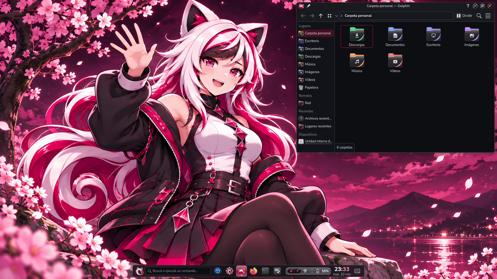
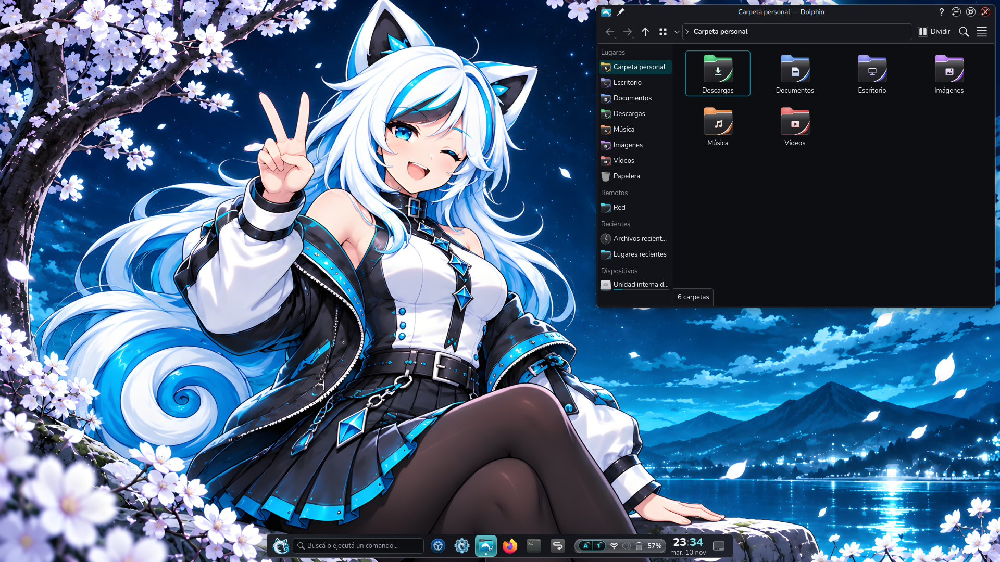
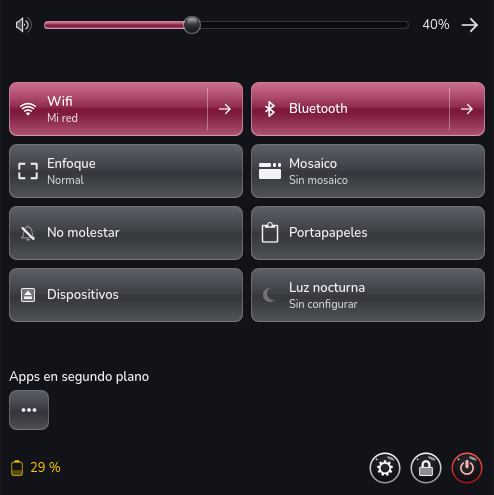
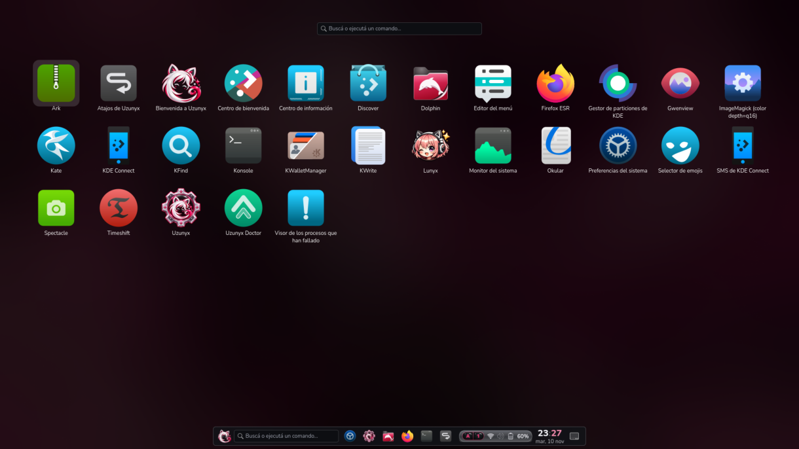

<p align="center">
  
</p>

<p align="center">
  Una distribución basada en <b>Debian testing</b> con <b>KDE Plasma (Wayland)</b>
  y un escritorio propio.
</p>



Uzunyx se instala desde su ISO, que arranca una sesión en vivo para probarla sin
tocar el disco y trae su propio instalador. El sistema que queda es Debian testing
con el escritorio de Uzunyx ya listo: tema, panel, ventanas, terminal, arranque e
inicio de sesión, sin configurar nada a mano.

Viene en dos ediciones que comparten todo salvo el color: **Akane** (carmesí) y
**Sora** (cian). Se cambia de una a otra en un clic, sin tocar el panel.



## Qué trae

**Ventanas**
- Esquinas de 8 px siempre, también maximizadas, y un margen de 8 px a los bordes de
  la pantalla. Las apps que dibujan su propio marco (Firefox, Electron, libadwaita)
  reciben el mismo borde y el mismo redondeo.
- Botones de ventana de bola brillante iguales en KDE, GTK, Firefox y Electron.
- Animaciones al abrir y cerrar, minimizar con forma de genio como en macOS,
  pantalla completa en un escritorio propio y un Alt+Tab estilo Cover Switch.
- Mosaico automático opcional («Principal y pila» y «Espiral»), con atajos para la
  mano izquierda, divisiones que se arrastran y escritorios dinámicos.

**Panel**
- Flotante, centrado y ajustado al contenido, aunque haya ventanas maximizadas.
- Gestor de tareas estilo Unity con un punto por ventana, paginador, reloj propio.
- Centro de control al estilo de GNOME: wifi, Bluetooth, sonido, brillo, batería,
  reproductor, portapapeles, apps en segundo plano y dispositivos extraíbles, todo
  en una píldora del panel.



**Tsunyx**, el menú de aplicaciones a pantalla completa, con un buscador que también
ejecuta comandos, calcula e inicia temporizadores (repositorio aparte).



**Además**
- Esquemas de color, tema de escritorio, iconos (Kora con carpetas propias), fondos,
  pantalla de bloqueo, inicio de sesión (SDDM), pantalla de salir, KSplash,
  Plymouth y GRUB a juego.
- Terminal: zsh con Oh My Zsh, autocompletado en vivo, Atuin y un prompt de Starship
  por edición, sin tocar el shell del usuario.
- Bienvenida para usuarios nuevos y una ventana con todos los atajos (`Super+Espacio`).

## Instalar

1. Descarga la [ISO de Uzunyx 0.2.0](https://dl.uzunyx.com/iso/0.2.0/uzunyx-0.2.0-amd64.iso)
   (unos 2 GB, PC de 64 bits, BIOS o UEFI) y comprueba la descarga con sus
   [sumas SHA256](https://dl.uzunyx.com/iso/0.2.0/uzunyx-0.2.0-SHA256SUMS). El código
   fuente de los paquetes de Debian que trae está en la
   [release v0.2.0](https://github.com/antarest47/uzunyx/releases/tag/v0.2.0).
2. Grábala en un USB, por ejemplo con Balena Etcher, Impression o `dd`.
3. Arranca desde el USB. Se abre la sesión en vivo y, sobre ella, el instalador
   (Calamares): idioma, teclado, disco, usuario y, si hay internet, una selección
   ampliada de aplicaciones (LibreOffice, Thunderbird, VLC, GIMP…).
4. Al reiniciar, la bienvenida te deja elegir entre Akane y Sora.

Secure Boot todavía no está probado: si la ISO no arranca, desactívalo.

### En un Debian que ya tienes

Si prefieres no reinstalar, `uzunyx-installer` es un solo `.deb` que lleva todos los
paquetes de Uzunyx. Pasa el sistema a Debian testing si hace falta (pregunta antes y
guarda copia), instala Plasma si falta y después el escritorio.

```bash
sudo apt install ./uzunyx-installer_*.deb
```

```bash
sudo uzunyx-install
```

Los efectos de KWin escritos en C++ (`uzunyx-outline`, `uzunyx-openclose`,
`uzunyx-genie`, `uzunyx-altguard`) se compilan contra una versión exacta de KWin. Si
el sistema tiene otra, apt los omite y el resto funciona.

## Compilar

Cada carpeta es un paquete y se arma con `make deb`; el `.deb` queda en su `build/`.
Las dependencias de compilación de cada uno están en su README.

```bash
make -C uzunyx-installer deb
```

```bash
make -C uzunyx-iso iso
```

El primero junta los `.deb` de todas las carpetas en el instalador; el segundo arma la
ISO sin root con `mmdebstrap`. Ver [uzunyx-iso/README.md](uzunyx-iso/README.md).

## Paquetes

| Paquete | Qué hace |
|---|---|
| [`uzunyx-iso`](uzunyx-iso) | ISO en vivo e instalable |
| [`uzunyx-installer`](uzunyx-installer) | Instalador en un solo `.deb` para un Debian existente |
| [`uzunyx-desktop`](uzunyx-desktop) | Metapaquete: instala el escritorio completo |
| [`uzunyx-lnf`](uzunyx-lnf) | Temas globales Akane y Sora, disposición del panel, pantallas de salir, bloqueo e inicio |
| [`uzunyx-editions`](uzunyx-editions) | Cambia de edición (`uzunyx-edition`) y su módulo en Configuración del sistema |
| [`uzunyx-deco`](uzunyx-deco) | Decoración de ventanas, scripts de KWin (maximizar suave, pantalla completa) y Alt+Tab |
| [`uzunyx-plasmatheme`](uzunyx-plasmatheme) | Tema de escritorio de Plasma |
| [`uzunyx-colors`](uzunyx-colors) | Esquemas de color de Plasma y Konsole |
| [`uzunyx-buttons`](uzunyx-buttons) | Botones de ventana, tema GTK `Breeze-Uzunyx` y tema de iconos |
| [`kora-icons`](kora-icons) | Receta para empaquetar los iconos Kora |
| [`uzunyx-wallpapers`](uzunyx-wallpapers) | Fondos y tema de SDDM |
| [`edge-gaps`](edge-gaps) | Márgenes en los bordes de la pantalla y modo enfoque |
| [`uzunyx-tasks`](uzunyx-tasks) | Gestor de tareas |
| [`uzunyx-pager`](uzunyx-pager) | Paginador |
| [`uzunyx-clock`](uzunyx-clock) | Reloj y calendario |
| [`uzunyx-controlcenter`](uzunyx-controlcenter) | Centro de control |
| [`uzunyx-lockkeys`](uzunyx-lockkeys) | Aviso de Bloq Mayús y Bloq Num |
| [`uzunyx-logout`](uzunyx-logout) | Botón de salir del panel |
| [`uzunyx-tiling`](uzunyx-tiling) | Mosaico automático, escritorios dinámicos y gestos |
| [`uzunyx-outline`](uzunyx-outline) | Efecto de KWin: borde y redondeo de ventanas sin decoración |
| [`uzunyx-openclose`](uzunyx-openclose) | Efecto de KWin: abrir y cerrar ventanas |
| [`uzunyx-genie`](uzunyx-genie) | Efecto de KWin: minimizar con forma de genio |
| [`uzunyx-altguard`](uzunyx-altguard) | Plugin de KWin: que Alt no abra el menú de la app tras un atajo |
| [`uzunyx-shortcuts`](uzunyx-shortcuts) | Atajos globales |
| [`uzunyx-keys`](uzunyx-keys) | Ventana con todos los atajos |
| [`uzunyx-timer`](uzunyx-timer) | Temporizadores |
| [`uzunyx-terminal`](uzunyx-terminal) | zsh, Starship, Atuin y fastfetch |
| [`uzunyx-welcome`](uzunyx-welcome) | Bienvenida |
| [`uzunyx-plymouth`](uzunyx-plymouth) | Pantalla de arranque |
| [`uzunyx-grub`](uzunyx-grub) | Tema y menú oculto de GRUB |
| [`lunyx`](lunyx) | Receta para Lunyx, cliente de biblioteca de anime |

## Estado del proyecto

Uzunyx es un proyecto personal y experimental, hecho en mi tiempo libre. Se ofrece
tal cual, sin garantía: úsalo bajo tu propia responsabilidad y con copia de tus datos.
Los issues y las propuestas son bienvenidos, pero no hay soporte garantizado y puede
que no responda a todos.

## Licencia

El código es GPL-3.0-or-later y las imágenes CC0-1.0. Las partes adaptadas de KDE y
de terceros conservan su licencia. Detalles en [COPYRIGHT.md](COPYRIGHT.md).

Debian, KDE, Plasma y Firefox son marcas de sus dueños. Uzunyx no es un proyecto
oficial de ninguno de ellos.
